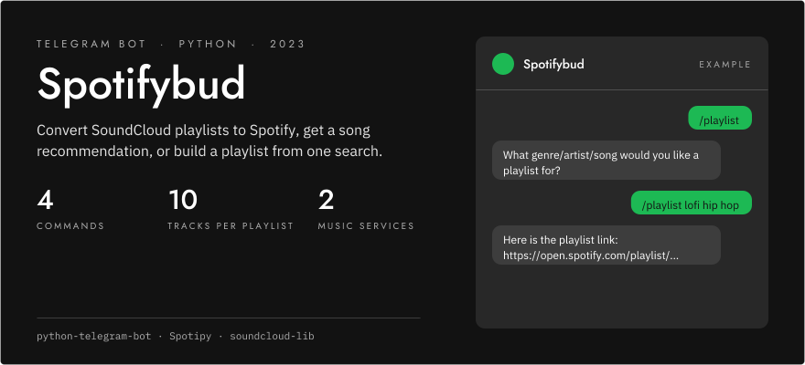
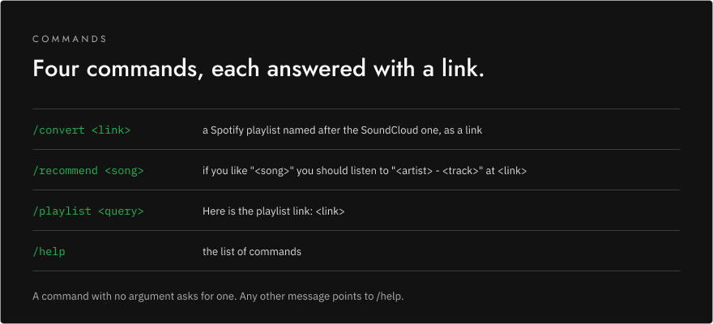
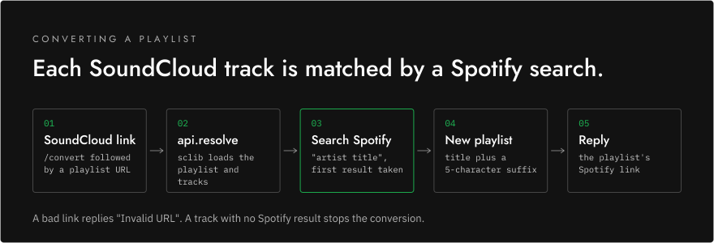
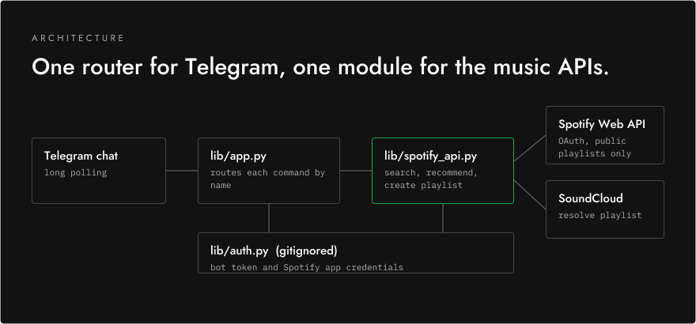

<p align="center">
  <picture>
    <source media="(prefers-color-scheme: dark)" srcset="assets/readme/hero-dark.svg">
    <source media="(prefers-color-scheme: light)" srcset="assets/readme/hero-light.svg">
    
  </picture>
</p>

<p align="center">
  <strong>A Telegram bot that converts SoundCloud playlists to Spotify, recommends songs, and builds playlists from one search.</strong><br>
  <sub>Python, python-telegram-bot, Spotipy and soundcloud-lib. Bot: <a href="https://t.me/spotifybuddy_bot">@spotifybuddy_bot</a> (it only responds while <code>app.py</code> is running) <!-- verify: bot is still registered --></sub>
</p>

<p align="center">
  
  
  
</p>

---

Spotifybud does common Spotify tasks from a Telegram chat. Send it a SoundCloud playlist link and it rebuilds the playlist on Spotify. Send it a song and it suggests a similar one. Send it any search term and it makes a 10-track playlist and replies with the link.

## Demo

Convert a SoundCloud playlist:


Get a recommendation:


Generate a playlist:


## Commands

<p align="center">
  <picture>
    <source media="(prefers-color-scheme: dark)" srcset="assets/readme/commands-dark.svg">
    <source media="(prefers-color-scheme: light)" srcset="assets/readme/commands-light.svg">
    
  </picture>
</p>

`/recommend` and `/playlist` share one helper. It searches Spotify for your text, takes the top track's ID, and calls the recommendations endpoint with that track as the seed. `/recommend` replies with the first result; `/playlist` puts all 10 into a new public playlist on the bot owner's account.

## Converting a playlist

<p align="center">
  <picture>
    <source media="(prefers-color-scheme: dark)" srcset="assets/readme/convert-dark.svg">
    <source media="(prefers-color-scheme: light)" srcset="assets/readme/convert-light.svg">
    
  </picture>
</p>

`sclib` resolves the SoundCloud URL into a playlist and its tracks. For each track the bot searches Spotify for the artist and title and takes the first match. New playlist names get a 5-character suffix from Python's `secrets` module, so the bot can find the playlist it just created among the account's playlists and add the tracks to it.

## Architecture

<p align="center">
  <picture>
    <source media="(prefers-color-scheme: dark)" srcset="assets/readme/architecture-dark.svg">
    <source media="(prefers-color-scheme: light)" srcset="assets/readme/architecture-light.svg">
    
  </picture>
</p>

`lib/app.py` is the Telegram side: one handler takes every command and routes it by name to a function that returns the reply text. `lib/spotify_api.py` holds all the Spotify and SoundCloud calls. Credentials stay in a gitignored `auth.py` module, and the Spotify scope is limited to `playlist-modify-public`.

| Area | Tools |
|---|---|
| Language | Python |
| Bot framework | python-telegram-bot (async `ApplicationBuilder`, long polling) |
| Spotify | Spotipy with the OAuth authorization-code flow |
| SoundCloud | `soundcloud-lib` (`sclib`) |
| Packaging | PyInstaller (Windows `.exe` in `app/`) |

## Getting started

You need a Telegram bot token from [@BotFather](https://t.me/BotFather) and a Spotify app from the [Spotify developer dashboard](https://developer.spotify.com/dashboard) with a redirect URI set.

1. Install the dependencies (there's no `requirements.txt` yet):

   ```sh
   pip install python-telegram-bot spotipy soundcloud-lib
   ```

2. Create `lib/auth.py`:

   ```python
   token = "<telegram bot token>"
   spotify_client_id = "<spotify client id>"
   spotify_client_secret = "<spotify client secret>"
   redirect_uri = "<redirect uri registered for your Spotify app>"
   ```

3. Start the bot:

   ```sh
   cd lib
   python app.py
   ```

   On the first Spotify call, Spotipy opens a browser to authorise your Spotify account and caches the token in `.cache`. Playlists are created on that account.

## Known limitations

- Every playlist is created on the bot owner's Spotify account, not the account of the person chatting.
- Spotify limited access to the recommendations endpoint for new apps in late 2024, so `/recommend` and `/playlist` may not work with a newly created Spotify app. <!-- verify -->
- `/convert` assumes every SoundCloud track has a Spotify match. A track with no search result makes the conversion fail.
