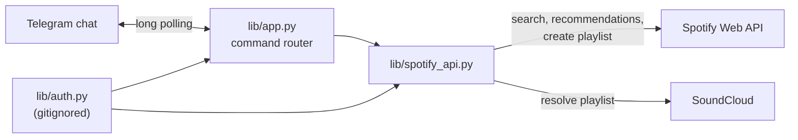

# Spotifybud

A Telegram bot that converts SoundCloud playlists to Spotify, recommends songs, and builds Spotify playlists from a song, artist or genre.


## Demo

<!-- TODO: demo link or video -->

Bot: [@spotifybuddy_bot](https://t.me/spotifybuddy_bot) (it only responds while `app.py` is running) <!-- verify: bot is still registered -->

Convert a SoundCloud playlist:


Get a recommendation:


Generate a playlist:


## Overview

Spotifybud does common Spotify tasks from a Telegram chat. Send it a SoundCloud playlist link and it rebuilds the playlist on Spotify. Send it a song and it suggests a similar one. Send it any search term and it makes a 10-track playlist and replies with the link.

## Key features

| Command | What it does |
|---|---|
| `/convert <soundcloud playlist link>` | Resolves the SoundCloud playlist, finds each track on Spotify by artist and title, and creates a Spotify playlist named after it |
| `/recommend <song>` | Finds the song on Spotify and replies with one similar track and its link |
| `/playlist <song, artist or genre>` | Creates a public Spotify playlist of 10 similar tracks and replies with the link |
| `/help` | Lists the commands |

Messages that aren't commands get a pointer to `/help`, and each command asks for its argument if you leave it out.

## Tech stack

| Area | Tools |
|---|---|
| Language | Python |
| Bot framework | python-telegram-bot (async `ApplicationBuilder`, long polling) |
| Spotify | Spotipy with the OAuth authorization-code flow |
| SoundCloud | `soundcloud-lib` (`sclib`) |
| Packaging | PyInstaller (Windows `.exe` in `app/`) |

## Architecture

`lib/app.py` is the Telegram side: one handler takes every command and routes it by name to a function that returns the reply text. `lib/spotify_api.py` holds all the Spotify and SoundCloud calls.



## Technical highlights

- Recommendations and generated playlists use one helper: search Spotify for the query, take the top track's ID, and call the recommendations endpoint with it as the seed.
- Conversion maps tracks across services by searching Spotify for each SoundCloud track's artist and title and taking the first match.
- New playlist names get a 5-character suffix from Python's `secrets` module, so the bot can find the playlist it just created among the account's playlists and add tracks to it.
- Credentials stay in a gitignored `auth.py` module, and the Spotify scope is limited to `playlist-modify-public`.

## Getting started

You need a Telegram bot token from [@BotFather](https://t.me/BotFather) and a Spotify app from the [Spotify developer dashboard](https://developer.spotify.com/dashboard) with a redirect URI set.

1. Install the dependencies (there's no `requirements.txt` yet):

   ```sh
   pip install python-telegram-bot spotipy soundcloud-lib
   ```

2. Create `lib/auth.py`:

   ```python
   token = "<telegram bot token>"
   spotify_client_id = "<spotify client id>"
   spotify_client_secret = "<spotify client secret>"
   redirect_uri = "<redirect uri registered for your Spotify app>"
   ```

3. Start the bot:

   ```sh
   cd lib
   python app.py
   ```

   On the first Spotify call, Spotipy opens a browser to authorise your Spotify account and caches the token in `.cache`. Playlists are created on that account.

## Known limitations

- Every playlist is created on the bot owner's Spotify account, not the account of the person chatting.
- Spotify limited access to the recommendations endpoint for new apps in late 2024, so `/recommend` and `/playlist` may not work with a newly created Spotify app. <!-- verify -->
- `/convert` assumes every SoundCloud track has a Spotify match. A track with no search result makes the conversion fail.
